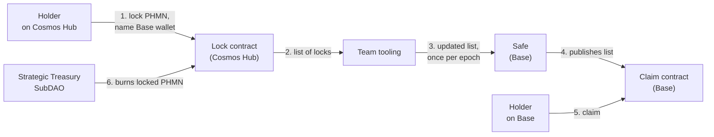

# ADR-0001: Moving PHMN from Cosmos Hub to Base

- **Status:** Proposed
- **Date:** 2026-11-20
- **Detailed by:** [ADR-0002 Lock contract on Cosmos Hub](0002-lock-contract-cosmos-hub.md),
  [ADR-0003 Claim contract and token on Base](0003-claim-contract-base.md),
  [ADR-0004 Off-chain tooling](0004-off-chain-tooling.md)

## In short

PHMN moves from Cosmos Hub to Base. A holder sends their PHMN to a lock
contract on Cosmos Hub and names the Base wallet that should receive it.
Once per epoch the team's Safe on Base publishes an updated list of everyone
who has locked. The holder then claims the same amount of PHMN on Base. The
locked PHMN on Cosmos Hub is burned.

The swap is 1:1, one-way and open-ended: there is no deadline.

## Context

- POSTHUMAN is moving its ecosystem to Base. The NFT avatars are already moving
  ([nft-avatars](https://github.com/Validator-POSTHUMAN/nft-avatars)).
  Only the POSTHUMAN validator stays on Cosmos.
- PHMN today is a Cosmos Hub TokenFactory token: 131,072 PHMN in total, held by
  about 13,000 addresses. It was itself created in June 2026 to replace the
  compromised Juno CW20 PHMN.
- The token is managed by the Strategic Treasury SubDAO, a 3-of-5 group on
  DAO DAO. Only it can mint or burn PHMN, and it can burn only tokens it holds.
- Governance moves to Snapshot, and the SubDAOs are replaced by a Safe on
  Base. Both are covered by separate ADRs.
- There is no direct bridge between Cosmos Hub and Base.

## Decision

1. **Lock.** The holder sends PHMN to the lock contract and names their Base
   wallet. A lock cannot be undone. The first lock from a Cosmos address fixes
   its Base wallet: later locks from that address to a different wallet are
   rejected.
2. **Publish.** Once per epoch the team's tooling builds a cumulative list:
   each Base wallet with the total it is owed. The list is a merkle tree; only
   its root goes on-chain. The tree and all proofs are published openly and can
   be rebuilt by anyone from Cosmos Hub data.
3. **Approve.** The Safe signs the new root. It becomes active only after a
   waiting period (24–48 h), during which it can be stopped.
4. **Claim.** The holder claims on Base whenever they like. The contract pays
   the difference between what the wallet is owed and what it has already
   received, so one claim covers any number of locks.
5. **Burn.** From time to time the SubDAO takes the locked PHMN out of the lock
   contract and burns it, in one proposal.

**Who holds which keys**

| Role | Who | Can do |
|---|---|---|
| Strategic Treasury SubDAO (Cosmos Hub) | 3 of 5 members | Burn locked PHMN; upgrade the lock contract; mint PHMN on Cosmos Hub |
| Safe (Base) | team signers | Publish new roots; upgrade the claim contract after a 7-day delay |
| Guardian (Base) | separate key or small Safe, different signers | Pause the claim contract; cancel a pending root or upgrade |

**PHMN on Base** is an ordinary token with exactly 131,072 PHMN and no way to
create more. The whole supply sits in the claim contract at launch. The
SubDAOs' current holdings move the same way as everyone else's: they are
locked on Cosmos Hub with the Safe as the receiver.

## Guarantees

- **No more out than in.** Nobody can receive more PHMN on Base than was
  locked on Cosmos Hub, and the total on Base can never exceed 131,072.
- **Nothing counted twice.** Each wallet receives only the difference between
  what it is owed and what it has already claimed.
- **No minter on Base.** The Base token supply is fixed forever.
- **Open-ended.** A holder can migrate at any time, with no deadline (under discussion right now).
- **Publicly checkable.** Anyone can compare what was locked on Cosmos Hub with
  what is claimable on Base.
- **No single point of failure for claims.** Proofs can be rebuilt from public
  Cosmos Hub data; no specific server is needed.

## What can go wrong and how we mitigate it

| What happens | Effect | Mitigation |
|---|---|---|
| Holder names a wrong Base wallet | Their PHMN goes to a wallet nobody controls; cannot be redirected | Wallet is taken from the connected Base wallet, not typed; first-lock binding catches a wrong account on later locks; explicit confirmation screen |
| Someone floods the lock contract with tiny locks | More data to process | Minimum lock amount; each lock costs the sender a Cosmos fee; our cost is one root per epoch regardless of lock count |
| A wrong root is published (tooling bug) | Wrong amounts would become claimable | Waiting period before activation; signers run an independent checker; guardian can cancel or pause; a wallet's total can never go down between roots |
| The Safe is compromised | Attacker tries to publish a root paying themselves or to upgrade the contract | Root waits 24–48 h and an upgrade 7 days; guardian cancels; the claim contract holds the only supply and has no withdraw function |
| The guardian is compromised | Attacker pauses claims | Guardian can only pause and cancel; the Safe unpauses and replaces the guardian |
| The SubDAO mints extra PHMN on Cosmos Hub and locks it | Takes part of the Base supply meant for holders who have not migrated yet | Supply monitor alerts on any change; guardian stops the root before it activates; requires 3 of 5 SubDAO members |
| Our proof hosting disappears | Holders cannot fetch proofs | Proofs mirrored on IPFS and GitHub; open script rebuilds them from Cosmos Hub data |
| Bug in the lock contract | Locks fail or are recorded wrongly | Contract is upgradeable by the SubDAO; audit before launch |
| Bug in the claim contract | Claims fail or pay wrongly | Guardian pauses; fix via upgrade after a 7-day delay; audit before launch |
| Cosmos Hub again restricts contract uploads | Lock contract cannot be upgraded quickly | The deployed contract keeps working; an upgrade would need Hub governance |
| Holder's PHMN is staked in the DAS, in a pool or on another chain | Cannot lock right away | Instructions for unstaking (14 days) and returning PHMN to Cosmos Hub; no deadline |
| The team stops publishing roots for a while | Migration pauses | Nothing is lost: locks stay recorded and are included in the next root |

## Consequences

- The SubDAO keeps the ability to mint PHMN on Cosmos Hub. Removing it would
  make the lock contract impossible to fix. We accept this and rely on
  monitoring and the waiting period on Base.
- Part of the Base supply sits in the claim contract indefinitely, for holders
  who have not migrated yet.
- Holders pay a Cosmos Hub fee to lock and Base gas to claim.
- The team takes on a permanent duty: build, check and sign a root each epoch,
  and keep the proofs published.
- DAS voting on Cosmos Hub loses meaning as PHMN leaves; governance moves to
  Snapshot.
