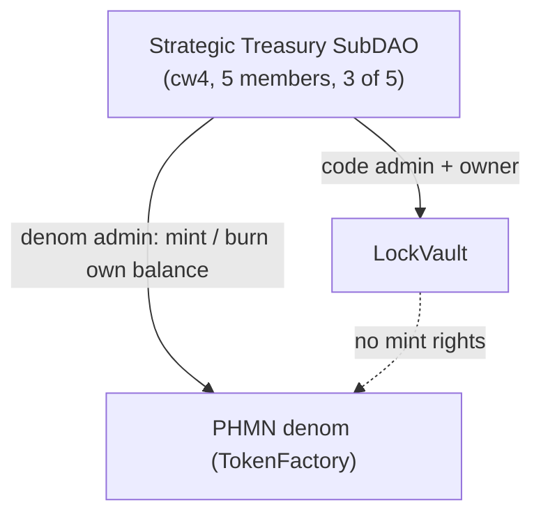
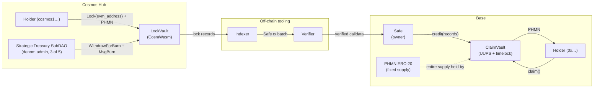
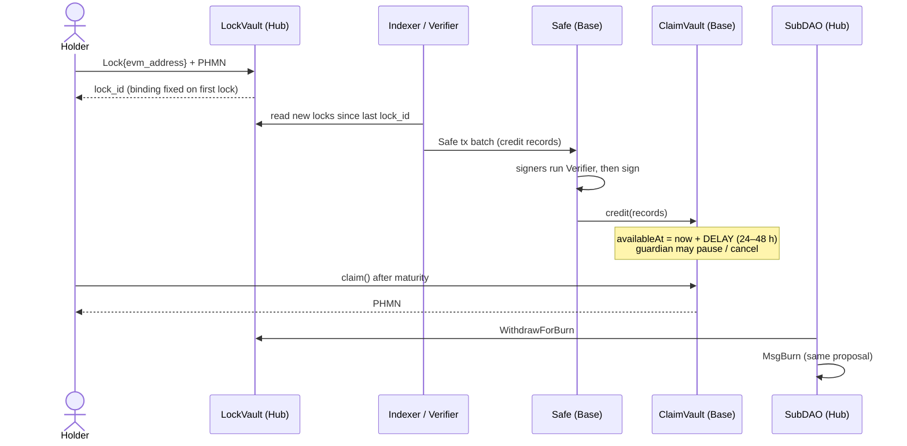
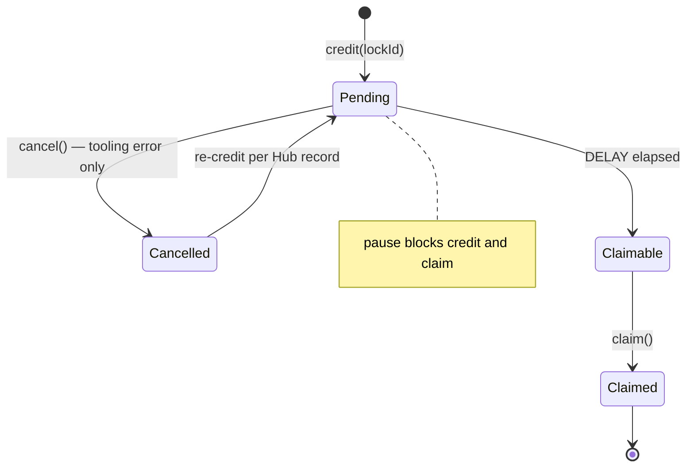
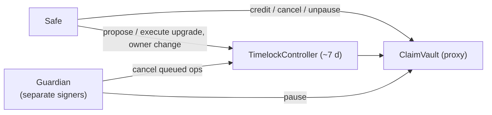

# PHMN: Cosmos Hub → Base Migration — Design, Part 1: Token Transfer

Date: 2026-11-19. Status: draft for review.

This is one part of the overall migration design. The other parts (separate
documents in `docs/design/`): Snapshot-based governance and the lock contract
on Base (see §8), and the NFT avatar migration
(`Validator-POSTHUMAN/nft-avatars`).

## 1. Why

POSTHUMAN is moving its ecosystem to Base (the NFT avatars are already being
moved — `Validator-POSTHUMAN/nft-avatars`). PHMN has to move with it. Only the
POSTHUMAN validator stays on Cosmos; the DAS, SubDAOs and pools on the Hub are
wound down. Governance is replaced by Snapshot (voting power from locked PHMN
on Base) and a Safe takes the place of the SubDAOs.

The migration mechanism is a simple one-way "bridge": a holder locks PHMN on
the Hub, specifying their Base address; the Safe carries that information into
a claim contract on Base; the holder claims PHMN on Base. The PHMN locked on
the Hub is burned.

## 2. Goals, non-goals, anti-goals

**Goals**
- Any holder of the new PHMN on the Hub can, at any time (open-ended), swap it
  1:1 for PHMN on Base.
- Accounting is transparent: anyone can reconcile "locked on Hub" against
  "credited on Base".
- Minimal ongoing infrastructure: the contracts run by themselves; people only
  need to collect signatures periodically.

**Non-goals (v1)**
- A two-way bridge (Base → Hub is not supported).
- Accepting PHMN directly from Osmosis/Neutron (IBC holders first move their
  tokens back to the Hub).
- The lock contract for Snapshot and the Snapshot space itself — a separate
  stage (§8).
- PHMN liquidity on Base (the Safe handles that separately).
- The old PHMN (CW20 on Juno `juno1rws84…`): its migration was completed in
  2026-06 by directly distributing the new PHMN according to a snapshot
  (`coin-drop/PHMN-MIGRATION-CONTEXT.md`). LockVault accepts only the
  TokenFactory denom; supply on Base = 131,072.

**Anti-goals (failure, even if it "works")**
- More PHMN can be obtained on Base than was locked on the Hub.
- One lock is credited twice.
- The ability to claim depends on a server/file that someone has to host
  forever.
- A minter appears on Base (the previous incident was a compromised CW20
  minter).

## 3. Current state (verified on-chain 2026-11-19)

| Item | Value |
|---|---|
| Network | Cosmos Hub, Gaia v29.1.0; wasm `code_upload_access = Everybody` (temporarily closed in Sept 2026 — CWA-2026-006) |
| Denom | `factory/cosmos146s5j3t7gh2g37ywm47dp8avhesu2htvjjaxq7z55e7xj0rq0k8q5qnjjy/PHMN`, 6 decimals |
| Supply | 131,072 PHMN, fully minted |
| Holders on Hub | 13,077 addresses (+ IBC vouchers on Osmosis `ibc/243B39…`, Neutron `ibc/0D72F3…`) |
| TokenFactory admin | Strategic Treasury SubDAO `cosmos146s5…` (its own admin, not a sub-DAO of the DAS) |
| SubDAO governance | `dao-voting-cw4`: 5 members × 1000, majority with 60% quorum, 24 h voting period, only_members_execute |
| SubDAO balance | ≈ 29,763.69 PHMN |
| Liquidity SubDAO `cosmos1pu90…` | ≈ 16,656.97 PHMN |
| DAS `cosmos1lj6k…` | `dao-voting-token-staked` `cosmos15naf…`: ≈ 31,105.8 PHMN staked, 14-day unbonding |
| Pools | Osmosis pool 3477 (PHMN/BTC), Astroport Neutron PHMN/USDC |

TokenFactory limitation on the Hub: `burn-from` is disabled — the admin can
only burn from its own balance. So locked tokens must reach the SubDAO's
balance before they are burned.

## 4. Key design choices

Alternatives that were evaluated and not taken are summarised in the Appendix.

### 4.1 Credit model

Credits are recorded directly on-chain by the Safe. The Safe calls
`credit([{lockId, account, amount}])`, the contract deduplicates by `lockId`,
and the user calls `claim()` with no proofs.

Because everything lives in the contract, nothing has to be hosted forever
(no proof files or proof servers), every `lockId` on the Hub maps to exactly
one record on Base so anyone can reconcile 1:1, and double-credit protection
is built into the contract itself. The cost is the Safe's gas (roughly
~45–50k gas/record, on the order of a few dollars per thousand records on
Base; to be re-checked) and several transactions in "heavy" epochs.

### 4.2 Admin rights on the Hub

There are two separate rights:

- **Denom admin (TokenFactory)** — the right to mint PHMN and to burn PHMN held
  by the admin itself. `burn-from` is disabled on the Hub, so the admin cannot
  burn tokens sitting on other addresses.
- **Code admin (wasm-admin)** — the right to migrate a contract to new code.

Assignment:

- **Denom admin = Strategic Treasury SubDAO.** Burning is done by its
  proposals: one proposal contains `LockVault.WithdrawForBurn` followed by
  `MsgBurn`.
- **LockVault is not a denom admin**, so it has no mint rights. It is
  upgradeable: **code admin = the SubDAO**, and `owner` = the SubDAO.

Consequence: the SubDAO (3 of 5 keys) can mint on the Hub and replace LockVault
code. This is covered in §7 (supply monitor, public visibility, credit timelock
and pause on Base). Supply on Base is fixed, so minting on the Hub never
creates new tokens on Base — it can only take the share of holders who have not
locked yet.

## 5. Architecture

#### End-to-end flow

#### Credit lifecycle in ClaimVault

### 5.1 LockVault (Cosmos Hub, CosmWasm, Rust)

- `Lock { evm_address }` + funds: accepts **only** the PHMN denom, amount > 0
  (minimum is up to the builder), validates `evm_address` as `0x` + 40 hex,
  non-zero. Assigns a monotonic `lock_id`, stores
  `{lock_id, sender, evm_address, amount, height, time}`, emits an event.
- **Binding by first lock.** The first lock from a `sender` fixes
  `binding[sender] = evm_address`. A later lock from the same `sender` with a
  different address is rejected with the error `EvmAddressMismatch { bound }`.
  Comparison is case-insensitive (store normalized to lowercase). The reverse
  is allowed: several `cosmos1…` addresses may lock to one `0x`. There is no
  way to reset a binding — whoever loses their Base wallet moves the PHMN to a
  new `cosmos1…` and locks from there.
- A lock is irreversible: there is no refund function for the user.
- `WithdrawForBurn { amount }` — `owner` (SubDAO) only, sends PHMN to the
  SubDAO. In **one** proposal the SubDAO calls `WithdrawForBurn` and `MsgBurn`,
  so locked funds are never mixed with the treasury.
- `Pause/Unpause` of new locks — `owner`.
- Queries: config, `lock(lock_id)`, `binding { cosmos_address }`, a paginated
  list of locks from `lock_id`, aggregates `total_locked`,
  `total_withdrawn_for_burn`.
- wasm-admin = SubDAO (code migrations). `owner` = SubDAO (changed via owner).
- Risk: if code uploads on the Hub are closed again, the already-deployed
  contract keeps working, but migrating to new code would require Hub
  governance.

### 5.2 PHMN on Base (ERC-20)

- Fixed supply 131,072, 6 decimals (amounts map 1:1 to the Hub with no
  conversion), no `mint`, no owner. The entire supply goes to ClaimVault at
  deployment.
- The SubDAO / Liquidity SubDAO holdings migrate **by the same path** — a lock
  on the Hub with the Safe's address. One accounting path, no "off-book"
  issuance on Base.

### 5.3 ClaimVault (Base, Solidity/Foundry)

- `owner` = Safe. `credit(Record[] {uint64 lockId, address account, uint256 amount})`:
  for each `lockId` — revert/skip if already credited; otherwise a credit with
  `availableAt = now + DELAY` (DELAY — 24–48 h, final value decided at
  deployment).
- **No redirection.** The `account` and `amount` of every
  record must match the `evm_address`/`amount` of the lock on the Hub. A user's
  mistake in the address is the user's mistake; the credit stays at the
  specified address.
- `cancel(lockId)` — owner only, only while the credit has not matured and only
  for tooling errors. Re-crediting that `lockId` is again strictly per the Hub
  record.
- `claim()` (and `claimFor(account)` — the transfer always goes to `account`) —
  pays out matured, not-yet-paid amounts.
- `pause/unpause` — `guardian` can pause, only the owner can unpause. Pause
  blocks `claim` and `credit`.
- **Upgradeability:** UUPS proxy. `upgrade` and owner changes go only
  through a `TimelockController` with a delay of ~7 days (proposer/executor =
  Safe). The `guardian` is the timelock's canceller + pauser. There is no
  sweep/rescue function. The guardian is a separate key or a small Safe with
  **different** signers than the main Safe. Result: a compromised Safe cannot
  quietly drain the supply (an upgrade sits publicly for a week and the
  guardian cancels it), while a bug can still be fixed by an honest upgrade.

- Invariant: `totalCredited − totalCancelled ≤ balance + totalClaimed`; the
  contract physically cannot pay out more than the supply.
- Events on every credit/cancel/claim — for reconciliation.

### 5.4 Tooling (TypeScript)

- **Indexer**: reads LockVault page by page from the last processed `lock_id`,
  builds batches for `credit` (size tuned to the Base gas limit, target
  300–500 records), and outputs Safe Transaction Builder JSON.
- **Verifier**: independently rebuilds the data from the Hub and compares it
  with the calldata of the proposed Safe transaction and with what is already
  credited on-chain; any mismatch in `lockId`/`account`/`amount` against the
  Hub is a hard error, with no exceptions; signers run it before signing.
  Report: total locked on the Hub, total credited/cancelled/claimed on Base,
  and the lag.
- **Monitor** (nice to have): the denom's supply on the Hub (growth = the
  SubDAO minted more), the LockVault balance, Hub↔Base discrepancies.

### 5.5 Frontend

- Lock page: Keplr/Leap connection; the Base address is **taken from the
  connected EVM wallet** (not typed by hand), with an explicit irreversibility
  confirmation. Before signing it queries `binding`: if the `cosmos1…` is
  already bound to a different `0x`, it shows the bound address and does not
  let the transaction be submitted.
- Claim page: wagmi/viem, shows credited / maturing / claimed.
- Hints for IBC holders and DAS stakers (14-day unbonding).

## 6. Operational order (high level)

1. Development + tests (cw-multi-test, Foundry), testnets (Hub testnet / Base
   Sepolia).
2. Audit of LockVault and ClaimVault.
3. Deploy the Safe on Base, PHMN, ClaimVault; deploy LockVault on the Hub.
4. Announcement; DAS — a withdrawal proposal (14-day unbonding), Liquidity
   SubDAO — pulls liquidity from the Osmosis/Astroport pools and locks its
   holdings to the Safe.
5. Regular epochs: indexer → verifier → Safe signatures → timelock → claims.
6. Periodically the SubDAO burns what has accumulated in LockVault.

## 7. Risks

- **The SubDAO can mint more PHMN on the Hub** (3 of 5 keys). This does not
  create new tokens on Base (supply is fixed), but it would let them take the
  share of those who have not locked yet. Mitigation: supply monitor,
  transparency, timelock + pause.
- **Wrong `evm_address`** — irreversible. Mitigation: the address comes from
  the connected wallet; `cancel` within the timelock window does not help when
  the address is well-formed but belongs to someone else.
- **Safe compromise** — the credit timelock + guardian pause give a window to
  react; a ClaimVault upgrade goes through a 7-day timelock the guardian can
  cancel.
- **Guardian compromise** — it can only pause and cancel; the Safe unpauses and
  rotates the guardian through the timelock.
- **Wasm uploads closed on the Hub** — affects only LockVault upgrades.

## 8. Next stage (outside v1)

The lock contract for Snapshot on Base: locking PHMN → a non-transferable
token/NFT that Snapshot uses as voting power. Designed separately.

## 9. Defaults and assumptions

- 6 decimals on Base (1:1 with the Hub, no conversion).
- The whole supply sits on ClaimVault; the SubDAO holdings migrate by the same
  lock path to the Safe.
- The wasm-admin and owner of LockVault are the Strategic Treasury SubDAO.
- Burning is a single SubDAO proposal: `WithdrawForBurn` + `MsgBurn`.
- Pull model: users call `claim`; there is no airdrop.
- IBC holders first move their PHMN back to the Hub; accepting IBC deposits is
  outside v1.
- The frontend takes the Base address from the connected EVM wallet.

## 10. Left to the builder

ClaimVault storage layout, batch size, minimum lock amount, event format,
frontend stack, CI.

## Appendix: Alternatives considered

Short notes on options that were evaluated and not taken. They are kept for
reference (audits, future revisions); the sections above are authoritative.

### A. Carrying credits over to Base (see §4.1)

- **Cumulative merkle root.** Leaf `(addr, total amount to date)`; the Safe
  replaces the root every epoch; the contract tracks `claimed[addr]` and pays
  out the difference. One proof and one transaction per user regardless of how
  many times they locked. Rejected: the proofs must be hosted forever (if the
  server dies, nobody can claim even though the root is on-chain), each new root
  rewrites the whole history, and reconciliation against the Hub requires
  rebuilding the tree.
- **Append-only list of merkle roots.** Leaf `(epoch, addr, amount)`; each epoch
  adds a root and past epochs never change. Rejected: a user who locked in
  several epochs makes several claims (a `claimMany` helper only partly hides
  this), proofs still have to be hosted, and guarding against one lock being
  included in two epochs happens outside the contract.
- **Direct on-chain credits (adopted).** No proofs to host, 1:1 reconciliation
  by `lockId`, deduplication enforced by the contract. Trade-off: the Safe pays
  gas for every record and heavy epochs need several signed transactions.

### B. Denom admin and code admin on the Hub (see §4.2)

- **Immutable LockVault as denom admin (no wasm-admin).** Burning would need no
  humans (burn on lock or via a public `burn()`), and nobody — including the
  SubDAO — could mint on the Hub. Rejected: a bug in the contract could never be
  fixed, so the contract would need to be extremely small and audited to a
  higher bar than is practical here.
- **Separate multisig as denom admin.** Same mint risk as the SubDAO plus a
  second key set to maintain indefinitely. Rejected: the SubDAO already acts as
  a 3-of-5 multisig on the Hub.
- **Adopted:** the SubDAO stays denom admin and also holds LockVault's code
  admin and `owner`. Trade-off: it retains mint rights on the Hub (see §7)
